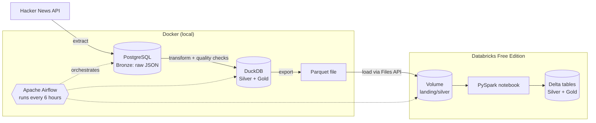

# Hacker News Data Pipeline

Batch data pipeline that snapshots the Hacker News front page every 6 hours. Airflow loads raw data into PostgreSQL (bronze); DuckDB parses, cleans, and quality-checks it into silver/gold layers and exports Parquet; Databricks then uses PySpark to build Delta tables tracking story scores, ranks, and posting-time trends. Everything runs locally in Docker.

**Stack:** Python, Apache Airflow, PostgreSQL, DuckDB, Docker, Databricks Free Edition (PySpark + Delta Lake), pgAdmin

## Why I built this

I work as a database engineer with SQL Server, where I build ETL/ELT pipelines using a Bronze, Silver, and Gold structure. I built this project to apply the same approach with modern, open-source and cloud data tools: Apache Airflow for orchestration, DuckDB for transformation, and Databricks with PySpark and Delta Lake for the cloud layer.

The goals were to:

- **Get hands-on experience with tools used in data engineering roles**, especially Airflow, Spark, and Databricks, which I don't use at work.
- **Build a complete, working pipeline end to end**, from a live API to cloud tables, including scheduling, data quality checks, and secure handling of secrets.
- **Keep it free to run**, using Docker locally and Databricks Free Edition instead of paid cloud services.

Hacker News was a good data source for this because its API is free and needs no key, and its front page changes constantly. That makes it possible to answer real questions with the data: which websites reach the front page most often, how a story's score and rank change over time, and whether the hour a story is posted affects how well it does.

## Architecture



| Layer | Where | Tables |
|---|---|---|
| Bronze | PostgreSQL | `raw_items` (raw API JSON, one row per story per snapshot) |
| Silver | DuckDB, Databricks | `silver_stories` (parsed, cleaned, quality-checked) |
| Gold | DuckDB, Databricks | `gold_story_latest`, `gold_domain_stats`, `gold_posting_hour` (Databricks only) |

### What each part does

- **Airflow** schedules and runs the three tasks in order, retrying failed tasks automatically.
- **PostgreSQL (bronze)** stores every API response untouched as JSONB. Each run adds a new snapshot in a single transaction, and a primary key on `(item_id, snapshot_ts)` prevents duplicates.
- **DuckDB (silver and gold)** is the transformation engine. It:
  - reads the raw JSON straight from Postgres, with no export step;
  - parses it into columns (title, URL, author, score, comment count, posting time);
  - extracts each story's website from its URL (posts without a URL, such as Ask HN, are labeled `news.ycombinator.com`);
  - drops non-story items and deleted or dead posts;
  - runs data quality checks and fails the run if a snapshot is empty or has null IDs or scores;
  - builds local gold tables in `data/hn.duckdb`;
  - exports each run's silver data as a Parquet file for Databricks.
- **Databricks** receives the Parquet files in a Unity Catalog volume, and a PySpark notebook builds Delta tables for analysis.

## Results

<!-- After the pipeline has collected a few days of data, add the chart:

-->

The `gold_posting_hour` table shows the average peak score of front-page stories by the hour they were posted (UTC). The pattern becomes more reliable as more snapshots are collected.

## Run it

You need Docker Desktop.

1. Copy `.env.example` to `.env`. Leave `DATABRICKS_HOST` blank for now if you only want the local part.
2. Create the secret files described under **Secrets** below (the token file can be empty for now). Docker needs both files to exist.
3. On Linux/macOS, set your user ID so Airflow can write to `data/`: `echo "AIRFLOW_UID=$(id -u)" >> .env` (skip on Windows).
4. Start everything:
   ```
   docker compose up --build
   ```
5. Get the Airflow password:
   ```
   docker compose exec airflow cat /opt/airflow/standalone_admin_password.txt
   ```
6. Open http://localhost:8080 and log in as `admin`.
7. Turn on the `hn_pipeline` DAG and trigger it. Without Databricks settings, the last task is skipped and the local pipeline still completes.

### Look at the local results

```
docker compose exec airflow python
```
```python
import duckdb
con = duckdb.connect('/opt/airflow/data/hn.duckdb', read_only=True)
con.sql('SELECT * FROM gold_domain_stats LIMIT 15').show()
```

### Browse Postgres with pgAdmin

Open http://localhost:8082 and log in with `PGADMIN_EMAIL` from `.env` and the password from your pgAdmin secret file. Register a server with Host `postgres`, Port `5432`, Username `airflow`, Password `airflow`, then open **Databases → hn → Schemas → public → Tables → raw_items**.

Postgres is also reachable from your machine on port **5433** (same user and password), for example with DBeaver.

## Add Databricks Free Edition

1. Sign up for Databricks Free Edition.
2. Import `databricks/hn_gold_notebook.py` into your workspace and run **only the first (setup) cell** on Serverless compute. It creates the `workspace.hn` schema and the `landing` volume.
3. Create a personal access token in your user settings (Developer section), with the **files** scope set to write access.
4. Put the token in the token secret file (see **Secrets**) and set `DATABRICKS_HOST` in `.env` to your workspace URL, ending at `.com`. Then restart: `docker compose down` and `docker compose up -d`.
5. Trigger the DAG. The Parquet file lands in `/Volumes/workspace/hn/landing/silver/`.
6. Run the full notebook to build the Delta tables.
7. Optional: create a Databricks job that runs the notebook, put its ID in `DATABRICKS_JOB_ID`, and Airflow will trigger it after each upload (the token then also needs a jobs scope with write access).

## Secrets

No passwords or tokens are stored in `.env` or anywhere in the project folder.

| Secret | File (outside the project) | Mounted in the container at |
|---|---|---|
| Databricks token | `%USERPROFILE%\.hn-secrets\databricks_token.txt` | `/run/secrets/databricks_token` |
| pgAdmin password | `%USERPROFILE%\.hn-secrets\pgadmin_password.txt` | `/run/secrets/pgadmin_password` |

- Docker Compose mounts these files as read-only secrets, so they never appear as environment variables or in Git.
- A local Claude Code settings file (`.claude/settings.local.json`, not committed) denies Claude Code's file tools access to `.env` and `~/.hn-secrets/`.
- Airflow, Postgres, and pgAdmin only listen on `127.0.0.1`, so other devices on your network can't reach them.
- The Databricks token is least-privilege (files scope only) and short-lived; revoke it in Databricks if it ever leaks.

Create the files on Windows (PowerShell):
```
mkdir $env:USERPROFILE\.hn-secrets
notepad $env:USERPROFILE\.hn-secrets\databricks_token.txt
notepad $env:USERPROFILE\.hn-secrets\pgadmin_password.txt
```
Paste the value, save, and close each one. Notepad keeps the values out of your PowerShell history.
(On macOS/Linux, set `USERPROFILE=$HOME` before running Docker Compose, or edit the `secrets` paths in `docker-compose.yml`.)

The Postgres password itself is the default `airflow`. That is acceptable because Postgres only accepts connections from this computer; a shared or production setup would move it to a secret as well.

## Data quality checks

- **Extract** fails the run if the API returns nothing, and inserts everything in one transaction (no partial loads).
- **Transform** fails the run if a snapshot produces no silver rows or has null IDs or scores.
- **The notebook** asserts there is data and no null keys before writing Delta tables.

## Design choices

- **Snapshots, not overwrites:** each run keeps a new copy of every story, so you can see how score and rank change over time.
- **Postgres as bronze:** raw JSON is kept untouched (JSONB), so silver can be rebuilt any time, even for snapshots the API can no longer return.
- **DuckDB for transforms:** reads raw JSON straight from Postgres, parses and cleans it into silver and gold layers, runs data quality checks, and exports Parquet for Databricks. It runs inside Python with no server, transforms each snapshot in under a second, and keeps only clean, compact files going to the cloud. Gold tables are built in both DuckDB (SQL, local) and Databricks (PySpark, cloud) to show the same logic on both platforms.
- **Databricks for the cloud layer:** Delta tables and PySpark at zero cost on Free Edition.
- **Logs on disk:** Airflow task logs are saved to `logs/` so they survive container restarts (ignored by Git).
